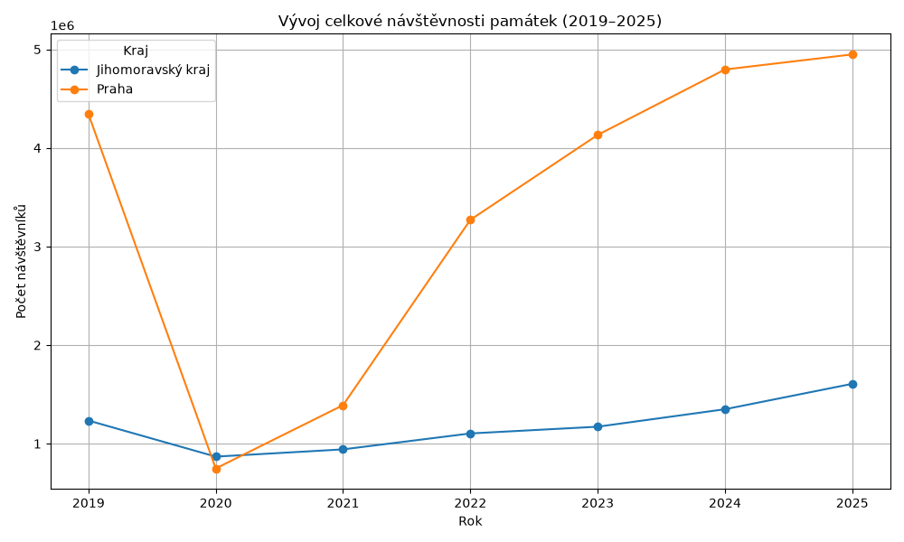
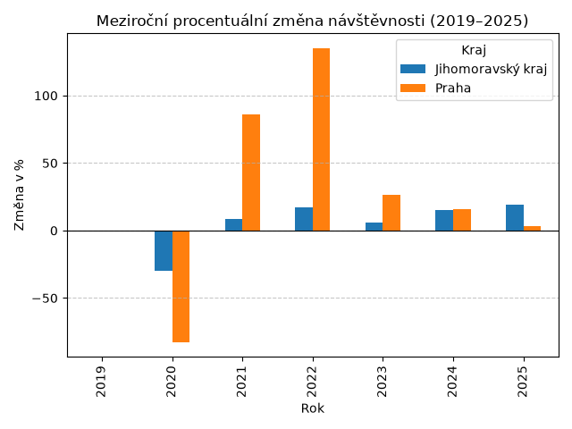
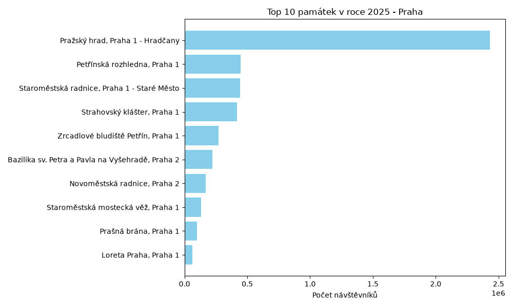
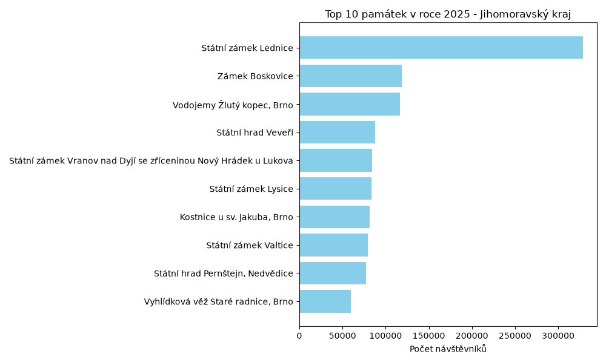
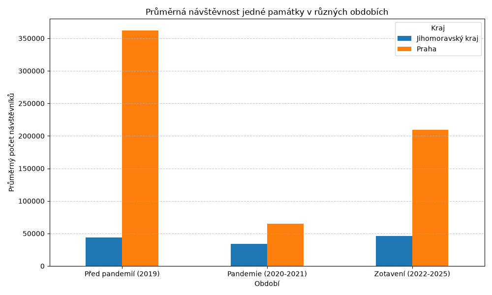
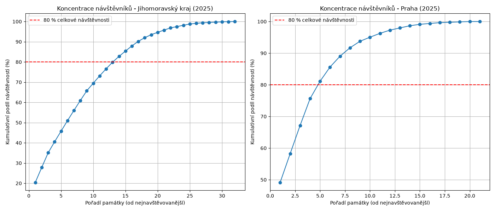

# Analýza návštěvnosti památek v Jihomoravském kraji a Praze

**Předmět:** Datová analýza  
**Autoři:** Marek Maněk  
**Vyučující:** [Doplnit jméno vyučujícího]  

---

## 1. Úvod a cíl projektu
Tato semestrální práce analyzuje návštěvnost památek v Jihomoravském kraji a Praze na základě otevřených dat. Cílem je identifikovat faktory ovlivňující návštěvnost, porovnat dopady pandemie covidu-19 a vizualizovat trendy v cestovním ruchu napříč odlišně vymezenými regiony.

### 1.1 Výzkumné otázky
1. Jaký byl celkový vývoj návštěvnosti památek v obou regionech v čase?
2. Jaké byly dopady pandemie covidu-19 v letech 2020–2021 a jak probíhalo zotavení?
3. Které památky jsou v každém regionu nejpřitažlivější?
4. Jak se liší koncentrace návštěvníků do nejnavštěvovanějších objektů v Praze oproti Jihomoravskému kraji?

## 2. Zdroj dat
### 2.1 Popis datasetu
* **Zdroj:** Agregované statistiky návštěvnosti turistických cílů (NIPOS / Tourdata)
* **Období:** 2019–2025
* **Lokalita:** Jihomoravský kraj, Hlavní město Praha
* **Počet záznamů:** [Doplnit po analýze, např. ~400]
* **Počet atributů:** 5 (finální vyčištěné sloupce)

### 2.2 Způsob získání dat
Data byla získána z oficiálních reportů návštěvnosti ve formátu XLSX pro jednotlivé kraje. Každý záznam v původních tabulkách představoval roční vývoj návštěvnosti konkrétního památkového objektu ve specifikovaném kraji.

## 3. Datový slovník a čištění
Proces čištění dat transformoval původní široký formát (roky jako sloupce) na relační formát vhodný pro analýzu, skládající se z 5 high-value sloupců. Během čištění byly odstraněny agregační řádky, textová metadata a neúplné záznamy.

**Numerické sloupce (2)**

| Sloupec | Typ | Popis | Příklad |
| :--- | :--- | :--- | :--- |
| Návštěvnost | int | Celkový počet návštěvníků objektu | 328477 |
| Rok | int | Rok, za který jsou data evidována | 2025 |

**Kategorické a textové sloupce (3)**

| Sloupec | Typ | Popis | Příklad |
| :--- | :--- | :--- | :--- |
| Název | string | Oficiální název památky | Státní zámek Lednice |
| Kraj | category | Územní příslušnost | Jihomoravský kraj |
| webové stránky | string | URL identifikátor objektu | www.zamek-lednice.com |

## 4. Kvalita dat a problémy

### 4.1 Identifikované problémy
**4.1.1 Nekonzistentní chybějící hodnoty:** 
V původních tabulkách se pro označení chybějících dat střídaly znaky jako tečka (`.`) a křížek (`x`). Tyto znaky způsobovaly, že celý sloupec s roční návštěvností byl datově interpretován jako text (object) namísto čísla.

**4.1.2 Skryté agregační mezisoučty:** 
Data obsahovala vložené součtové řádky za jednotlivé okresy. Pokud by nebyly odfiltrovány, vykazoval by dataset téměř dvojnásobnou celkovou návštěvnost.

**4.1.3 Extrémní odlehlé hodnoty (Outliery):** 
Pražský hrad dosahuje návštěvnosti přes 2,5 milionu osob ročně, což představuje masivní outlier vychylující průměrné statistiky v pražském regionu směrem nahoru.

### 4.2 Provedené opravy
1. Ignorování úvodních textových metadat při načítání (`skiprows`).
2. Odstranění všech řádků obsahujících klíčová slova „Celkem Okres“ nebo „Okres “.
3. Sjednocení znaků `.` a `x` na systémovou hodnotu `NaN`.
4. Přetypování sloupců s návštěvností na numerický formát (`to_numeric`).
5. Transformace dat ze širokého do dlouhého formátu pomocí funkce `pd.melt`.

### 4.3 Výsledek čištění

| Fáze | Počet záznamů | Počet sloupců |
| :--- | :--- | :--- |
| Původní data (široký formát) | ~70 památek | 9 |
| Po čištění a transformaci (melt) | [Doplnit z Pythonu] | 5 |

## 5. Metodologie zpracování

### 5.1 Použité nástroje
* **Python 3.14+**
* **Pandas** - manipulace a čištění dat
* **NumPy** - matematické operace a filtry
* **Matplotlib** - vizualizace výsledků

### 5.2 Postup zpracování
```text
JM_2019-25.xlsx & PR_2019-25.xlsx
↓
[1. Načíst Excel soubory přes pd.read_excel s úpravou skiprows]
↓
[2. Odfiltrovat agregační mezisoučty a prázdné hodnoty]
↓
[3. Nahradit nestandardní znaky (. a x) za NaN a přetypovat]
↓
[4. Sloučit a transformovat data pomocí pd.melt]
↓
[5. Generovat agregace a exportovat zakladni_statistiky.csv]
↓
[6. Vytvořit vizualizace přes Matplotlib]
↓
vystupy/vycistena_data.csv (finální dataset)
vystupy/*.png (vygenerované grafy)
```

### 5.3 Matematický aparát
**Meziroční procentuální změna:**  
Kvantifikace rychlosti poklesu či růstu trhu byla počítána vzorcem:
`Změna = ((Návštěvnost[t] − Návštěvnost[t-1]) / Návštěvnost[t-1]) × 100`

**Kumulativní podíl návštěvnosti (Koncentrace):**  
Pro vyhodnocení Paretova pravidla v turismu:
`Kumulativní podíl = (Σ návštěvnosti seřazených památek / Celková návštěvnost regionu) × 100`

## 6. Výsledky

### 6.1 Základní statistiky (Souhrn 2019–2025)

| Metrika | Jihomoravský kraj | Praha |
| :--- | :--- | :--- |
| Průměrná návštěvnost jedné památky | [Doplnit z CSV] | [Doplnit z CSV] |
| Medián návštěvnosti | [Doplnit z CSV] | [Doplnit z CSV] |
| Maximum (Nejnavštěvovaný objekt) | [Doplnit z CSV] | [Doplnit z CSV] |

### 6.2 Vizualizace

  
*Graf 1: Vývoj celkové návštěvnosti památek (2019–2025). Spojnicový graf znázorňuje absolutní propad cestovního ruchu v roce 2020 a následný postupný proces zotavení v obou krajích.*

  
*Graf 2: Meziroční procentuální změny. Sloupcový graf kvantifikuje šok z pandemie a ukazuje, který z regionů zaznamenal hlubší pád a který dynamičtější návrat turistů.*

  
*Graf 3: Žebříček deseti nejnavštěvovanějších památek v Praze (2025). Horizontální sloupcový graf ukazuje absolutní dominanci Pražského hradu v metropoli a výrazný odstup ostatních památek.*

  
*Graf 4: Žebříček deseti nejnavštěvovanějších památek v Jihomoravském kraji (2025). Na jižní Moravě vede žebříček návštěvnosti Státní zámek Lednice, trh je zde však rozložen podstatně rovnoměrněji.*

  
*Graf 5: Průměrná návštěvnost v klíčových obdobích. Porovnání tří fází trhu: předpandemické výkonnosti (2019), vlivu restrikcí (2020–2021) a aktuálního stavu zotavení (2022–2025).*

  
*Graf 6: Geografická a objektová koncentrace návštěvníků. Křivky kumulativního podílu dokazují, jak malý počet památek generuje drtivou většinu turistické zátěže (v Praze je tento jev výraznější).*

## 7. Diskuze

### 7.1 Hlavní zjištění
* **Rozdílná struktura trhu:** Praha je silně centralizovaná kolem jedné primární památky (Pražský hrad), zatímco Jihomoravský kraj disponuje rovnoměrněji rozloženou sítí památek.
* **Elasticita a covid-19:** Metropolitní turismus v Praze, vysoce závislý na zahraničních hostech a letectví, zaznamenal během pandemie podstatně tvrdší propad než Jihomoravský kraj, který se opřel o domácí turistiku.
* **Paretovo pravidlo:** Graf koncentrace prokázal, že v obou regionech obslouží naprostou většinu turistů nejvyšších 20 % zkoumaných objektů.

### 7.2 Omezení analýzy
* **Časové období:** Analýza pokrývá primárně roky zasažené globální pandemií, chybí širší období stabilního růstu před rokem 2019.
* **Nesrovnatelnost celků:** Praha těží z masivní tranzitní dostupnosti na minimálním prostoru, zatímco JMK je plošná destinace.
* **Metodika počítání:** Některé objekty evidují i průchody otevřeným areálem, jiné vykazují striktně prodané vstupenky do expozic.

## 8. Závěr
Analýza agregovaného datasetu návštěvnosti v letech 2019–2025 ukázala, že pandemický šok zásadním způsobem ovlivnil chod památkových objektů, přičemž regiony závislé na mezinárodním turismu utrpěly hlubší ztráty. Data prokázala silnou koncentraci návštěvníků do úzké skupiny nejznámějších objektů napříč oběma kraji. Projekt demonstruje kompletní postup datové analýzy v Pythonu – od načítání problematických excelových tabulek, přes jejich relační čištění, agregaci, až po finální interpretaci metrik a vizualizaci.

## 9. Přílohy

### 9.1 Struktura projektu
```text
Semestralni_prace/
├── analyza_pamatek.py    # Načtení, čištění a transformace
├── analyza_grafy.py      # Meziroční změny a žebříčky
├── analyza_dokonceni.py  # Kumulativní podíly a analýza období
├── JM_2019-25.xlsx       # Vstupní data JMK
├── PR_2019-25.xlsx       # Vstupní data Praha
└── vystupy/
    ├── vycistena_data.csv
    ├── zakladni_statistiky.csv
    └── *.png             # Vygenerované grafy
```

### 9.2 Výstupy
* `vystupy/vycistena_data.csv` – Vyčištěný centrální dataset ve strukturovaném formátu.
* `vystupy/zakladni_statistiky.csv` – Statistiky (průměry, mediány).
* `vystupy/*.png` – 6 exportovaných analytických vizualizací v tiskové kvalitě.